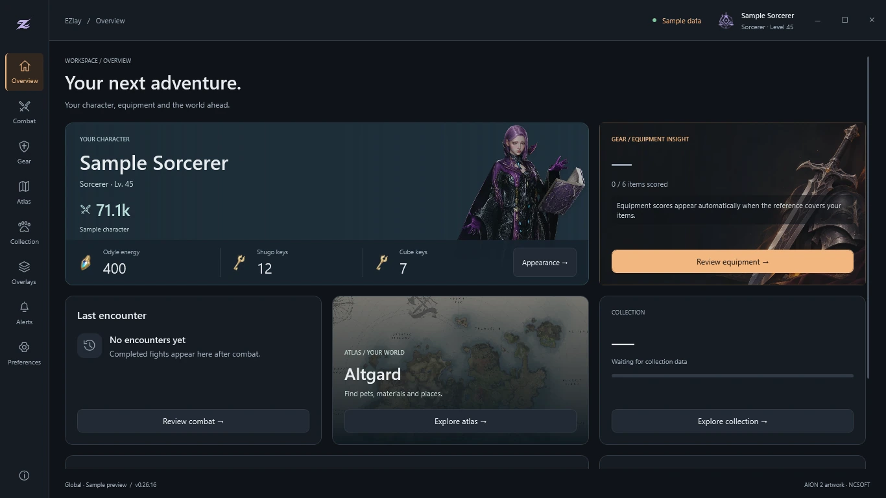
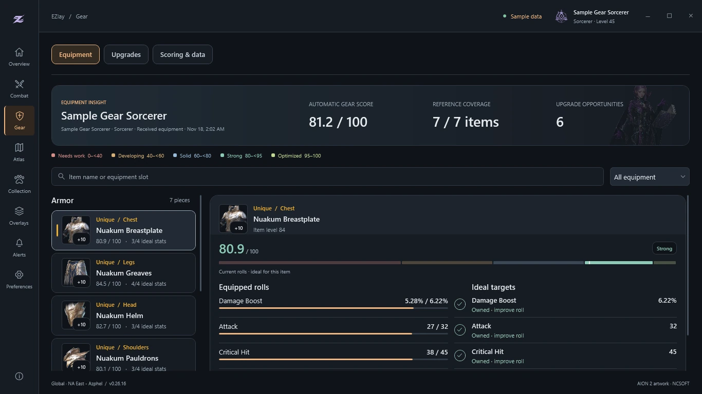

# EZlay

A free Windows companion for **AION 2**. Inspect equipment rolls, review party damage, and track pets and materials while you play.

[Download for Windows x64](https://github.com/Kinwan96/ezlay/releases/latest/download/EZlay-win-Setup.exe) · [Explore the app](https://kinwan96.github.io/ezlay/) · [Stable patch notes](https://github.com/Kinwan96/ezlay/releases/latest)

## Gear inspector

Select an equipped item on the left to compare its rolls with targets for that item and class. A checked circle marks a stat you already own. An empty circle marks a missing target. When a supported reroll could improve the score, EZlay lines it up with the stat it could replace.

## More tools

| Workspace | What you can do |
|---|---|
| Combat | Review party damage and inspect an individual player's skill breakdown. |
| Atlas and Collection | Filter documented material and pet locations, pin farming targets, and follow collection progress. |
| Alerts | See nearby cube signals and configure field boss reminders. |
| Overlays | Customize meter artwork and class colors, position your overlays, and lock the map independently. |

## Install and update

Download the stable installer above. EZlay is self-signed, so Windows may show a SmartScreen or publisher warning. Live capture uses [Npcap](https://npcap.com/#download), installed separately. Administrator mode is optional.

Installed copies can download stable patches in the app. Choose **Restart now** to apply a prepared update, or **Later** to keep playing. Each release lists its validation results and pending manual checks.

## Your data and support

EZlay keeps settings, saved encounters, character snapshots, and logs in `%LOCALAPPDATA%\EZlayData`. Uninstalling removes the app and keeps this folder for reinstalls. Review screenshots and logs before sharing them in a [bug report](https://github.com/Kinwan96/ezlay/issues).

EZlay is free and closed source. This repository hosts the website, stable downloads, reference data, and support resources. EZlay is an unofficial companion. AION 2 and game artwork belong to NCSOFT. Screenshots use sample data.
