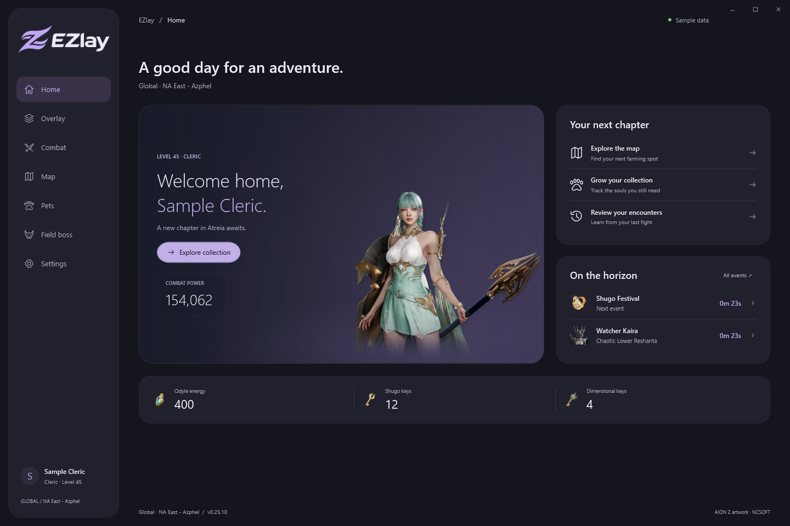

# EZlay

**A free Windows companion for AION 2.** Combat insights, interactive maps, pet farming and customizable overlays.

[Visit the homepage](https://kinwan96.github.io/ezlay/) · [Downloads & patch notes](https://github.com/Kinwan96/ezlay/releases) · [Report a problem](https://github.com/Kinwan96/ezlay/issues)

| Feature | What it helps with |
|---|---|
| Combat meter | Party damage and player skill breakdowns |
| Map & farming | Search documented pets, materials and cube locations |
| Pet collection | Family filters, progress and pinned farming targets |
| Alerts | Cube guidance and configurable field boss reminders |
| Overlay layouts | Position, size, transparency and separate map locking |

## Downloads

The first public installer is being prepared and internally tested. Only approved stable patches will be published. There is no public beta update channel.

EZlay is **free to use and closed source**. This repository contains the website, release information and support resources, not the application source.

## Requirements & support

Windows x64. Normal launches request administrator access for game input and menu detection. Combat capture uses Npcap, installed separately from [the official Npcap site](https://npcap.com/#download). Map markers are documented locations, not guaranteed live spawns. Cube arrows are north-up, not camera-relative.

When reporting a bug, include the app version, expected behavior and reproduction steps. Review screenshots and logs before posting; do not attach character databases, raw captures, credentials or private account information.

## Attribution

EZlay is unofficial and is not affiliated with or endorsed by NCSOFT. AION 2 and game artwork belong to their respective owners. Third-party components retain their licenses; notices will be included with the installer. Current releases are self-signed: Windows may show SmartScreen or Unknown publisher warnings. Never install a root certificate to run EZlay. Live-game, clean-install and installed-upgrade checks remain pending; see each release’s validation notes.
